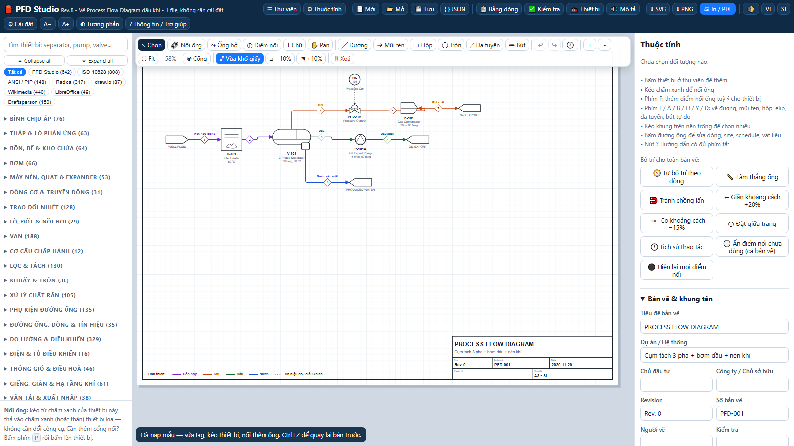

# PFD Studio (Process Flow Diagram Studio) — Rev.8 (26.11.11)

**Tiếng Việt** | [English](#english)

**PFD Studio** là ứng dụng thiết kế, mô phỏng và trực quan hóa sơ đồ công nghệ (Process Flow Diagram - PFD) phục vụ ngành dầu khí và xử lý công nghệ.

Ứng dụng chạy hoàn toàn độc lập (Offline / Single-file HTML), không cần cài đặt máy chủ, không phụ thuộc internet.



---

## Tính Năng Cốt Lõi (Rev.8 — Một Phần Mềm Duy Nhất)
- **Thư viện chuẩn hóa 1.188 ký hiệu công nghệ:**
  - 144 ký hiệu gốc PFD Studio + 1.043 ký hiệu mở theo chuẩn ISO 10628, ANSI/ISA-5.1, PIP từ các nguồn uy tín: Draftsperson, Radica, LibreOffice, draw.io, Wikimedia.
  - Phân loại trực quan thành 22 họ thiết bị (Bình tách, Tháp, Bơm, Máy nén, Thiết bị trao đổi nhiệt, Van, v.v.). Mỗi nhóm có droplist biến thể theo nguồn.
- **Tính năng giao diện thông minh:**
  - Nút **Collapse all / Expand all**; nút **lọc nguồn** (PFD Studio, ISO, ANSI/PIP, Radica, draw.io, Wikimedia, LibreOffice, Draftsperson) — vẫn giữ cây thiết bị, chỉ lọc biến thể.
  - Cổng nối (ports) mặc định đặt chính xác theo đầu ống vật lý của ký hiệu (van 2 cổng, máy nén/bơm theo ống hút/đẩy…); người dùng có thể tự do thêm bớt cổng.
  - Tự động bắt dính, tạo nhánh chữ T (Tee), đổi hướng, làm thẳng ống (phím `J`).
- **Xuất bản vẽ kỹ thuật cao cấp:** Định dạng SVG vector và PDF độ phân giải cao.

---

## Cấu Trúc Mã Nguồn Repository
```
PFD-Studio/
├── index.html                          # Bản phát hành chính Rev.8 (chạy ngay trên mọi trình duyệt)
├── pfd-studio-26.11.11-Rev.8.html     # Bản đóng gói Rev.8 chính thức
├── r8/                                 # Toàn bộ mã nguồn module hóa Rev.8
│   ├── assemble.py                     # Script đóng gói thành 1 file duy nhất (python3 r8/assemble.py)
│   ├── base7.html                      # Khung trang + CSS
│   ├── js/                             # Logic xử lý giao diện, canvas, thao tác vẽ
│   ├── lib/                            # Thư viện mã ký hiệu (open_lib.js, taxo.js, lib*.js)
│   ├── tools/                          # Bộ công cụ phân loại & sinh thư viện (taxo.py, build_lib.py)
│   └── fontwork/                       # Bộ font kỹ thuật nhúng sẵn
├── symbol-library/                     # Bản quyền & tài liệu giấy phép nguồn ký hiệu
│   └── LICENSE-attribution.md
├── apps/                               # Các bản phân phối HTML độc lập (Rev.7, Rev.8, Rev.8.5)
├── lib/                                # Thư viện JS/CSV dữ liệu bổ trợ
├── scripts/                            # Pipeline script chuẩn hóa SVG và đóng gói
└── docs/                               # Hồ sơ đặc tả, báo cáo tích hợp
```

---

## Hướng Dẫn Khởi Chạy
1. **Chạy ngay:** Mở trực tiếp file `index.html` hoặc `pfd-studio-26.11.11-Rev.8.html` bằng bất kỳ trình duyệt web nào (Chrome, Edge, Firefox).
2. **Đóng gói mã nguồn từ `r8/`:** Chạy lệnh `python r8/assemble.py` để biên dịch ra file HTML mới.

---

## Bản Quyền & Giấy Phép (Attribution)
Mã nguồn của PFD Studio theo giấy phép [MIT](LICENSE). Các ký hiệu nhập từ nguồn bên thứ ba giữ giấy phép riêng của nguồn đó.

Chi tiết điều khoản bản quyền và giấy phép của các nguồn biểu tượng mở được ghi nhận đầy đủ tại [`symbol-library/LICENSE-attribution.md`](symbol-library/LICENSE-attribution.md) và [`docs/LICENSE-attribution_v1.3.md`](docs/LICENSE-attribution_v1.3.md) (CC BY-SA 3.0/4.0, LGPL-3.0, Apache-2.0).


---

## English

**PFD Studio** is an application for designing and visualizing Process Flow Diagrams (PFD) for oil and gas and process engineering. It runs fully standalone (offline, single-file HTML): no server to install and no internet needed. The interface is mainly in Vietnamese.

### Core features (Rev.8)

- **Standardized library of 1,188 process symbols:**
  - 144 original PFD Studio symbols plus 1,043 open symbols following ISO 10628, ANSI/ISA-5.1 and PIP, taken from Draftsperson, Radica, LibreOffice, draw.io and Wikimedia.
  - Grouped into 22 equipment families (separators, columns, pumps, compressors, heat exchangers, valves and more). Each group has a dropdown of variants by source.
- **Smart interface:**
  - **Collapse all / Expand all** buttons and a **source filter** (PFD Studio, ISO, ANSI/PIP, Radica, draw.io, Wikimedia, LibreOffice, Draftsperson) that keeps the equipment tree and filters only the variants.
  - Connection ports are placed by default on the physical pipe ends of each symbol (two-port valves, compressor and pump suction and discharge, and so on). You can freely add or remove ports.
  - Automatic snapping, T-junction branches, re-routing, and pipe straightening (key `J`).
- **Technical drawing export:** vector SVG and high-resolution PDF.

### Repository layout

- `index.html` and `pfd-studio-26.11.11-Rev.8.html`: the Rev.8 release (open in any browser).
- `apps/`: standalone HTML builds (Rev.7, Rev.8, Rev.8.5).
- `r8/`: modular Rev.8 source (`assemble.py` packs it into one HTML file; `js/`, `lib/`, `tools/`, `fontwork/`).
- `symbol-library/` and `docs/`: licenses and attribution of symbol sources, integration reports.
- `lib/` and `scripts/`: supporting data and the conversion and normalization scripts.

### Getting started

1. Open `index.html` or `pfd-studio-26.11.11-Rev.8.html` in any web browser (Chrome, Edge, Firefox).
2. To rebuild from source in `r8/`, run `python r8/assemble.py`.

### License

PFD Studio's own code is released under the [MIT License](LICENSE). Symbols imported from third-party sources keep their own licenses (CC BY-SA 3.0/4.0, LGPL-3.0, Apache-2.0); see [`symbol-library/LICENSE-attribution.md`](symbol-library/LICENSE-attribution.md) and [`docs/LICENSE-attribution_v1.3.md`](docs/LICENSE-attribution_v1.3.md). If you redistribute the symbol library, follow those terms.
